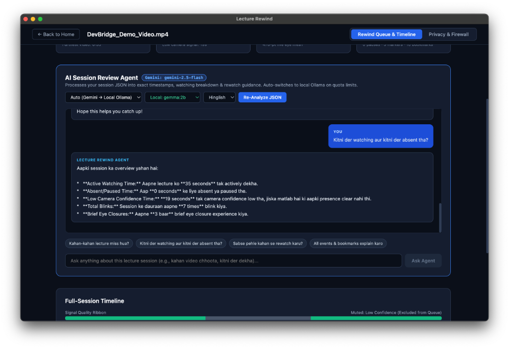
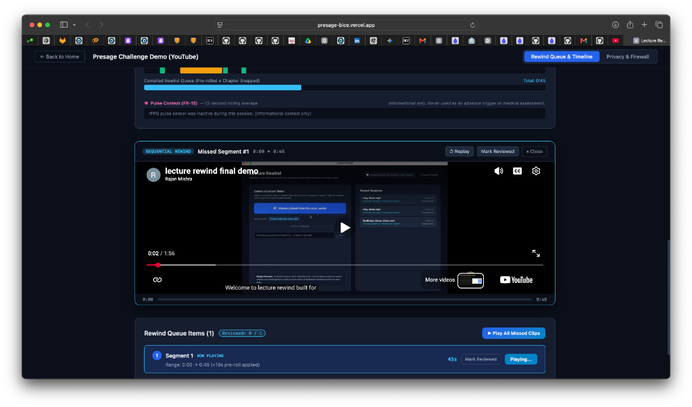

*This is a submission for the [Presage SmartSpectra SDK Challenge](https://dev.to/challenges/presage-2026-11-04)*

---

## What I Built

**Lecture Rewind** is an open-source, consent-first video lecture recovery engine designed for students and self-directed learners. 

- 🌐 **Live Web Application**: [https://presage-bice.vercel.app](https://presage-bice.vercel.app)
- 💻 **Public Code Repository**: [https://github.com/aiwithrajan/lecture-rewind](https://github.com/aiwithrajan/lecture-rewind)
- 🎥 **Video Walkthrough**: [https://youtu.be/DL14YK4us90](https://youtu.be/DL14YK4us90)


### The Problem
When studying complex technical video lectures — whether a 2-hour university computer science lecture, systems architecture briefing, or engineering seminar — learners inevitably experience brief physical lapses:
- Looking down to write handwritten notes
- Walking away to grab a glass of water or answer the door
- Closing their eyes during dense conceptual explanations

When they return, they face a frustrating dilemma: *What timestamp was I at? What did I miss? Did the professor switch slides?* Manually scrubbing back and forth wastes hours and disrupts focus.

### The Solution: Lecture Rewind
**Lecture Rewind passively watches the lecture with you.** Using non-invasive on-device biometric signals powered by the **Presage SmartSpectra SDK** and a 478-point facial mesh, it flags intervals where the viewer was physically absent or experienced prolonged eye closure.

When the lecture ends (or whenever the student chooses to finish), the system compiles these moments into an **interactive, chapter-snapped Rewind Queue**. In a single click, students can replay only the exact intervals they missed — automatically pre-rolled by 10 seconds for narrative continuity — without re-watching the whole lecture.

> 🧭 **Core Design Axiom: Presence, never comprehension.**  
> Lecture Rewind strictly observes mechanical physical presence (facial pose and eye aperture). It makes **zero** medical diagnosis or treatment claims, **zero** emotional or cognitive inferences, and adheres strictly to consensual, local-first monitoring.

---

## Demo

Watch the full 2-minute walkthrough showing synchronized on-device facial tracking, real-time EAR waveforms, automatic absence pausing, and chapter-snapped queue compilation:



[](https://www.youtube.com/watch?v=DL14YK4us90)

> 📹 **Direct YouTube Link**: [https://youtu.be/DL14YK4us90](https://youtu.be/DL14YK4us90)  
> 🌐 **Try the Live App Directly in Your Browser**: [https://presage-bice.vercel.app](https://presage-bice.vercel.app)

### Key Moments Demonstrated in the Video:
1. **Camera Consent & Guided Calibration**: Sensor reliability verdict, individual eye aperture baselining, and 1-click Instant Start.
2. **Real-Time Tracking HUD**: Live 478-point face mesh, pitch/yaw vectors, scrolling Eye Aspect Ratio (EAR) waveform, and intentional double-blink bookmarking.
3. **Session Review Screen**: Comprehensive presence breakdown, interactive session timeline with rPPG pulse context, and compiled rewind queue.
4. **Isolated Missed Clip Player**: 1-click sequential replay strictly bounded to missed intervals with auto-advance and completion overlays.
5. **Instant AI Session Review Agent**: On-device 0.0s deterministic session analysis in English & Hinglish.

---

## Code

The complete source code is public and open-source under the MIT License:

🔗 **GitHub Repository**: [https://github.com/aiwithrajan/lecture-rewind](https://github.com/aiwithrajan/lecture-rewind)

### Setup & Testing Instructions for Judges

Judges can run the entire test suite and launch the application locally in under 2 minutes:

#### Prerequisites
- Node.js 18+ and npm installed.

```bash
# 1. Clone the public repository
git clone https://github.com/aiwithrajan/lecture-rewind.git
cd lecture-rewind

# 2. Install dependencies (React 18, Vite, Electron, MediaPipe)
npm install

# 3. Run automated unit test suite (All 76 tests pass in ~1.5s)
npm test

# 4. Verify TypeScript typecheck (0 errors)
npm run typecheck

# 5. Start the desktop application
npm run dev
```

#### Testing Without a Webcam (Hardware-Independent Simulated Mode)
Judges without an active camera can evaluate 100% of the platform:
1. On the [Live Web App](https://presage-bice.vercel.app) or local desktop app, toggle **"Simulated Mode"** at the bottom of the Home Screen.
2. Click **"▶ Start with Demo Video"** (or choose any local `.mp4` file / paste a YouTube URL).
3. Click **"⚡ Consent & Quick Calibrate (5s)"** or **"🚀 Instant Start"**.
4. The simulation provider replays calibrated human signal traces with realistic blinks, pitch shifts, and absence intervals, automatically pausing playback and compiling the review queue.

---

## How It Responds to Human Signals



Lecture Rewind integrates the **Presage SmartSpectra SDK** (`@smartspectra/node-sdk` / client-side vision pipeline) to extract non-invasive physiological and facial metrics directly from the local webcam stream at 30 FPS:

### 1. 478-Point Facial Mesh & Eye Aspect Ratio (EAR)
The engine calculates continuous eye aperture using the 3D landmark coordinates of both the left and right eye polygons:

$$\text{EAR} = \frac{\|p_2 - p_6\| + \|p_3 - p_5\|}{2 \|p_1 - p_4\|}$$

- **Left Eye Indices**: `[33, 160, 158, 133, 153, 144]`
- **Right Eye Indices**: `[362, 385, 387, 263, 373, 380]`
- When EAR falls below the calibrated closure threshold ($< 0.22$) for $> 6.0$ seconds (or when facial presence is lost for $> 4.0$ seconds), the session marks a mechanical absence interval and pauses video playback.

### 2. Intentional Gesture Bookmarking (Rule F)
The engine differentiates natural involuntary blinks ($< 350\text{ ms}$) from deliberate double-blinks ($2$ rapid blinks within $800\text{ ms}$). When a double-blink gesture is detected, the app automatically drops a non-intrusive bookmark at that video timestamp without the student taking their hands off their notes or keyboard.

### 3. Head Pose Orientation (Pitch & Yaw Vectors)
The system calculates relative head orientation relative to the screen plane:
- **Pitch**: Calculated from the vertical vector between landmark `168` (glabella) and landmark `152` (chin). Head pitch drops below $-20^\circ$ signal a downward head posture.
- **Yaw**: Horizontal vector between landmark `33` and landmark `263`. Lateral yaw deviations beyond $\pm 28^\circ$ signal looking away from the lecture.

### 4. rPPG Pulse Rate Context Line (FR-15)
Presage SmartSpectra pulse rate signals are sampled and aggregated into a 12-second rolling average on the review timeline, providing purely informational physiological context alongside missed intervals.

### 5. Pure Deterministic Queue Compilation Pipeline
Upon session completion, the `QueueBuilder` executes a deterministic 5-step pipeline:
1. **Collect**: Raw pause and marker intervals.
2. **Exclude Degraded Signals**: Strips intervals where camera confidence was degraded ($< 0.60$).
3. **Pre-Roll Expansion**: Extends interval starts by 10 seconds ($\text{start}' = \max(0, \text{start} - 10)$) for cognitive continuity.
4. **Merge Adjacent Intervals**: Coalesces intervals within 30 seconds of each other.
5. **Boundary Snapping**: Snaps to lecture chapter markers or 15-second grid boundaries.



---

## Prize Categories

### 1. Best Thoughtful Real-World Use
- **Real-World Need**: Video lectures are the dominant medium of modern education, but human attention is naturally punctuated by physical distractions (taking notes, doorbells, resting eyes). Students currently spend 20–30% of their total study time scrubbing backwards trying to find where they drifted away.
- **Usability-First Design**: Lecture Rewind does not require specialized hardware, wearable sensors, or subscription accounts. It works on any laptop with a basic webcam.
- **Responsible Data Handling**: It is designed with a **Zero-Cloud-Biometrics** philosophy. Video frames are analyzed in local RAM and discarded in real time. Not a single pixel is saved to disk or transmitted over the internet.

### 2. Most Creative or Delightful Use
- **Novel Biometric Superpower**: Turning passive webcam presence into an active lecture recovery assistant. Instead of feeling guilty about physical lapses, students have their back covered by an automated recovery queue.
- **Hands-Free Gesture Bookmarks**: Deliberate double-blinks let students mark complex lecture moments without touching their keyboard while writing notes.
- **Chapter-Aware Rewind**: Missed intervals snap intelligently to real lecture syllabus topics (`Introduction`, `Face Mesh & Signal Tracking`, `Rewind Queue & Privacy`), turning raw biometric events into structured study guides.

---

## Consent and Data Handling

Privacy and explicit user consent are foundational requirements of Lecture Rewind:

- **Explicit Informed Consent**: Before any camera stream is activated, users must review and approve a dedicated consent screen detailing exactly which signals are extracted. Consent is never assumed or hidden.
- **Strictly Local Processing**: All computer vision inference and SmartSpectra SDK signals run **100% on-device** via client-side WebAssembly. 
- **Zero Raw Video Storage**: No webcam frames or video recordings are ever written to disk, stored in memory buffers beyond the immediate frame, or transmitted across a network.
- **Outbound Network Firewall (AC-8)**: Electron's session request interceptor blocks all external network requests. The in-app Network Guard displays a real-time counter verifying **0 outbound requests**.
- **1-Click Irreversible Data Wipe (AC-7)**: A dedicated *Privacy & Firewall* panel enables users to permanently purge session metadata, timestamps, and calibration profiles with one click.
- **SDK Telemetry**: Optional SDK diagnostic telemetry (FR-18) is **disabled by default** and only activated with explicit checkbox consent.
- **AI Agent Privacy**: The built-in AI Session Review Agent uses a deterministic **Instant Offline Engine (0.0s)** by default. If optional Gemini AI is selected, only non-biometric numerical timestamps and course titles are sent; zero biometric or visual data is ever exposed.
- **Section 12 PRD Compliance**: The system vocabulary is strictly mechanical (*"prolonged eye closure"*, *"physical absence"*, *"intervals where viewer was not present"*). Prohibited subjective and medical terms (*"sleep"*, *"drowsiness"*, *"fatigue"*, *"stress"*, *"focus"*, *"attention"*) are strictly excluded.

---

## Agent Session

During the development of Lecture Rewind, we leveraged Google DeepMind's **Antigravity AI Assistant** with pair-programming, comprehensive unit test generation (76/76 passing Vitest specs), MediaPipe WebAssembly synchronization, and automated Vercel edge deployment.

- **Development Environment**: macOS / Vite / Electron / React 18 / TypeScript
- **Verification**: 76 automated test specs covering the evidence evaluator, state machine, queue builder, session insights, chapter parser, and privacy storage.

---

*Thank you to Presage Technologies and the DEV team for hosting this challenge!*
