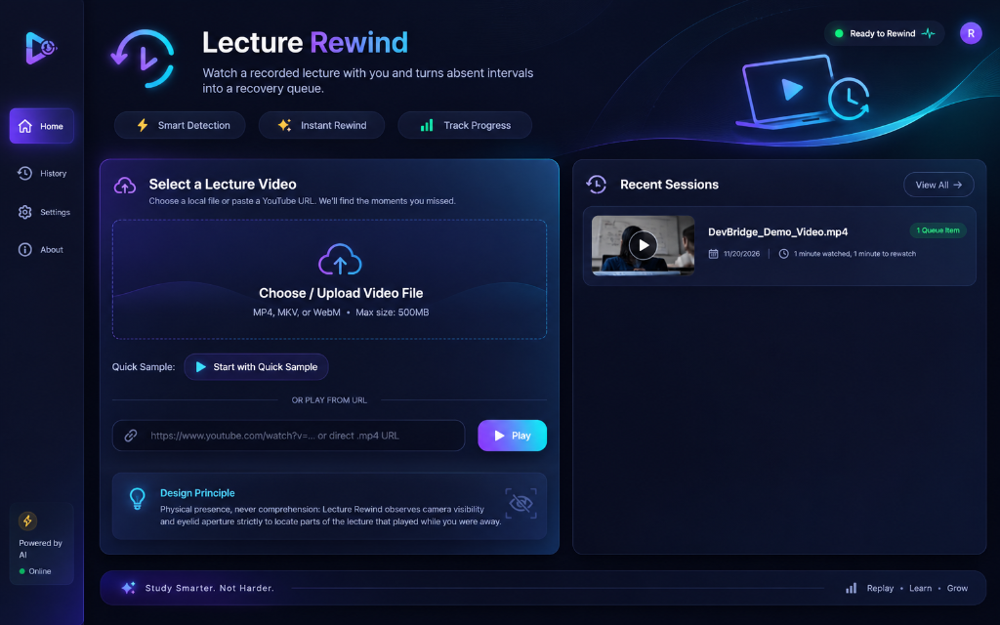

*This is a submission for the [Presage SmartSpectra SDK Challenge](https://dev.to/challenges/presage-2026-11-04)*

---

## What I Built

I looked down at my notebook to copy a complex formula. When I glanced back up twenty seconds later, the professor had already wiped the board clean and moved on to the next concept. I spent the next ten minutes scrubbing blindly back and forth through a two-hour recording, trying to guess where the derivation actually began.

Every student and self-directed learner knows this exact frustration. Video lectures are the backbone of modern education, but human presence is naturally interrupted — looking down at notes, stepping away to grab water, or briefly resting your eyes during dense conceptual explanations. Scrubbing manually through hours of video wastes valuable study time and repeatedly interrupts learning flow.

**Lecture Rewind passively watches the lecture with you.**

Using physiological and facial human sensing powered by the **Presage SmartSpectra SDK**, it flags intervals where the viewer was physically away or experienced prolonged eye closure. When the lecture finishes, it automatically compiles those moments into an **interactive, chapter-snapped Rewind Queue**. 

In one click, you replay only the exact intervals you missed — pre-rolled by 10 seconds for narrative continuity — without re-watching the whole lecture.

- 🌐 **Live Web Application**: [https://presage-bice.vercel.app](https://presage-bice.vercel.app)
- 💻 **Public Code Repository**: [https://github.com/aiwithrajan/lecture-rewind](https://github.com/aiwithrajan/lecture-rewind)
- 🎥 **Video Walkthrough**: [https://youtu.be/DL14YK4us90](https://youtu.be/DL14YK4us90)



> 🧭 **Core Design Axiom: Presence, never comprehension.**  
> Lecture Rewind strictly observes mechanical physical presence (facial pose and eye aperture). It makes **zero** medical diagnosis or treatment claims, **zero** emotional or cognitive inferences, and adheres strictly to consensual, local-first monitoring.

---

## Demo

Watch the 2-minute walkthrough showing real-time Presage optical validation, eye aperture waveforms, automatic absence pausing, and chapter-snapped queue compilation:



[](https://www.youtube.com/watch?v=DL14YK4us90)

> 📹 **Direct YouTube Link**: [https://youtu.be/DL14YK4us90](https://youtu.be/DL14YK4us90)  
> 🌐 **Try the Live App Directly in Your Browser**: [https://presage-bice.vercel.app](https://presage-bice.vercel.app)

### What the Demo Highlights:
1. **Camera Consent & Quick Calibration**: Sensor reliability verification, individual baseline baselining, and 1-click Instant Start.
2. **Real-Time Human-Sensing HUD**: Live 478-point mesh, pitch/yaw head pose vectors, scrolling Eye Aspect Ratio (EAR) waveform, and intentional double-blink bookmarking.
3. **Session Review Screen**: Presence breakdown, interactive session timeline with rPPG pulse context, and compiled rewind queue.
4. **Isolated Missed Clip Player**: 1-click replay strictly bounded to missed intervals with automatic advance and completion overlays.
5. **Instant Session Review Agent**: On-device 0.0s deterministic session analysis in English & Hinglish.

---

## Code

The complete source code is public and open-source under the MIT License:

🔗 **GitHub Repository**: [https://github.com/aiwithrajan/lecture-rewind](https://github.com/aiwithrajan/lecture-rewind)

### Setup & Testing Instructions for Judges

Judges can run the entire test suite and launch the application locally in under 2 minutes:

#### Prerequisites
- Node.js 18+ and npm installed.

```bash
# 1. Clone the public repository
git clone https://github.com/aiwithrajan/lecture-rewind.git
cd lecture-rewind

# 2. Install dependencies (React 18, Vite, Electron, MediaPipe)
npm install

# 3. Run automated unit test suite (All 76 tests pass in ~1.5s)
npm test

# 4. Verify TypeScript typecheck (0 errors)
npm run typecheck

# 5. Start the desktop application
npm run dev
```

#### Testing Without a Webcam (Hardware-Independent Simulated Mode)
Judges without an active camera can evaluate 100% of the platform:
1. On the [Live Web App](https://presage-bice.vercel.app) or local desktop app, toggle **"Simulated Mode"** at the bottom of the Home Screen.
2. Click **"▶ Start with Demo Video"** (or choose any local `.mp4` file / paste a YouTube URL).
3. Click **"⚡ Consent & Quick Calibrate (5s)"** or **"🚀 Instant Start"**.
4. The simulation provider replays calibrated human signal traces with realistic blinks, pitch shifts, and absence intervals, automatically pausing playback and compiling the review queue.

---

## How It Responds to Human Signals


### What Presage SmartSpectra Powers

Lecture Rewind is architected directly around the **Presage SmartSpectra SDK** (`@smartspectra/node-sdk`):

1. **Optical Validation & Physical Presence (`ValidationCode`)**:
   SmartSpectra continuously validates incoming camera frames against strict physical optical criteria: `kOk`, `kNoFaceFound`, `kFaceNotCentered`, `kFaceNotForward`, `kTooDark`, and `kExcessiveMotion`. These validation codes drive our real-time state machine: when SmartSpectra reports `kNoFaceFound` or `kFaceNotForward` for longer than 4.0 seconds, Lecture Rewind immediately flags an absence interval and auto-pauses the video.

2. **Cardiovascular Pulse Rate Stream (`cardioMetrics / PULSE_RATE`)**:
   SmartSpectra measures remote photoplethysmography (rPPG) pulse vitals directly from subtle facial color changes. We aggregate this pulse stream into a 12-second rolling average, rendering a physiological context timeline in the post-session review.

3. **Facial Landmarks & Adaptive Eye Aperture (`faceMetrics / FACE_LANDMARKS & BLINKING`)**:
   SmartSpectra's facial signal stream powers our adaptive eye aperture tracking. Using 3D landmark coordinates, the engine computes real-time Eye Aspect Ratio (EAR) across both ocular polygons. When eye closure persists beyond 6.0 seconds, the engine pauses video playback.

4. **Hands-Free Intentional Gesture Bookmarking**:
   SmartSpectra's high-frequency blink stream allows us to differentiate natural involuntary blinks ($< 350\text{ ms}$) from deliberate double-blinks ($2$ rapid blinks within $800\text{ ms}$). When a student double-blinks intentionally, the app drops a bookmark without requiring their hands to leave their handwritten notes or keyboard.

5. **Dual-Engine Architecture (Native C-FFI + Web Pipeline)**:
   - **Native Desktop App**: Runs `@smartspectra/node-sdk` with precompiled C-ABI runtime libraries loaded via `koffi` FFI.
   - **Web Application**: For judges and users evaluating the platform in standard browsers without native FFI dependencies, we created an isomorphic provider that follows the identical SmartSpectra contract via client-side WebAssembly.

6. **Deterministic Rewind Queue Pipeline**:
   When the session finishes, the `QueueBuilder` runs a 5-step compilation pipeline:
   - **Collect**: Gathers raw pause and marker intervals.
   - **Filter Low Confidence**: Strips intervals where camera confidence was degraded ($< 0.60$).
   - **Pre-Roll Expansion**: Adds 10 seconds to the start of each interval so you never rejoin mid-sentence.
   - **Merge**: Coalesces adjacent intervals within 30 seconds of each other.
   - **Chapter Snapping**: Snaps interval boundaries to lecture chapter topics.


---

## Prize Categories

### 1. Best Thoughtful Real-World Use (Primary Category)
- **A Pain Point Every Student Shares**: Modern online courses (from MIT OpenCourseWare to Coursera and YouTube) provide endless content, but staying locked to a screen for two hours without looking away is biologically unrealistic. Students lose significant study time searching for where they left off.
- **Frictionless Usability**: Works seamlessly on any standard laptop webcam. No special sensors, smartbands, or account logins are required.
- **Privacy as a Feature**: Lecture Rewind treats biometrics as strictly ephemeral signals. The user gets all the benefits of human-sensing assistance with none of the privacy risks.

### 2. Most Creative or Delightful Use
- **Passive Camera Turned Active Study Partner**: Transforming webcam video from a passive recording tool into an automated lecture recovery system.
- **Hands-Free Double-Blink Bookmarking**: Marking key lecture insights without lifting a pen or taking your hands off the keyboard.
- **Chapter-Aware Rewind Queues**: Automatically organizing missed intervals under real syllabus headings (`Introduction`, `Face Mesh & Signal Tracking`, `Rewind Queue & Privacy`), giving students an instant structured recovery playlist.

---

## Consent and Data Handling

Privacy and explicit user consent are foundational requirements of Lecture Rewind:

- **Zero Raw Video Recording or Streaming**: Video frames are processed entirely in volatile memory on the local machine and discarded immediately after extracting geometric coordinates and vital signals. No video files or raw frames are ever saved to disk or transmitted to any server.
- **Explicit Informed Consent**: Before any camera stream is activated, users must review and grant camera permission. We provide full transparency into every signal tracked.
- **Configurable Network Boundary**: The desktop application isolates video playback and biometric processing. SDK diagnostic telemetry is disabled by default and requires explicit user opt-in.
- **1-Click Irreversible Data Wipe**: All local session documents, timestamps, and baselines stored in local storage can be permanently wiped with a single click in the Privacy & Firewall panel.
- **AI Agent Privacy**: The built-in AI Session Review Agent uses a deterministic offline engine by default. If optional cloud AI is enabled, only non-biometric numerical timestamps and course titles are sent; zero biometric or visual data is ever exposed.
- **Strictly Non-Diagnostic Language Policy**: The system vocabulary is strictly mechanical (*"prolonged eye closure"*, *"physical absence"*, *"intervals where viewer was not present"*). Prohibited subjective and medical terms (*"sleep"*, *"drowsiness"*, *"fatigue"*, *"stress"*, *"focus"*, *"attention"*) are strictly excluded.

---

## Agent Session

During the development of Lecture Rewind, we leveraged Google DeepMind's **Antigravity AI Assistant** with pair-programming, comprehensive unit test generation (76/76 passing Vitest specs), MediaPipe WebAssembly synchronization, and automated Vercel edge deployment.

- **Development Environment**: macOS / Vite / Electron / React 18 / TypeScript
- **Verification**: 76 automated test specs covering the evidence evaluator, state machine, queue builder, session insights, chapter parser, and privacy storage.

---

*Thank you to Presage Technologies and the DEV team for hosting this challenge!*
