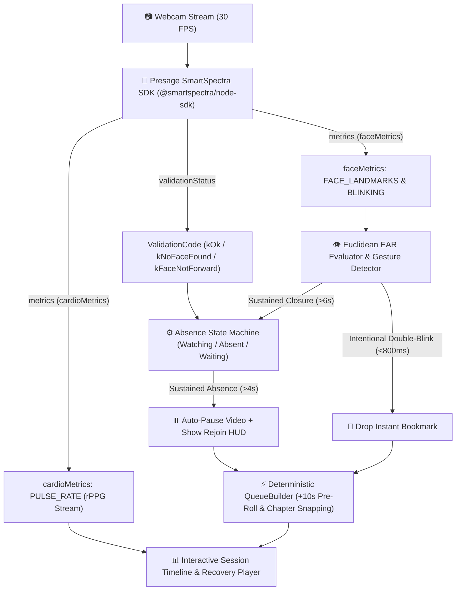

# Lecture Rewind

A consent-first lecture recovery engine powered by the **Presage SmartSpectra SDK**, **Electron**, **React 18**, and **TypeScript** that tracks physical presence via local camera signals and compiles missed intervals into a structured, chapter-snapped recovery queue.

- 🌐 **Live Web Demo**: [https://presage-bice.vercel.app](https://presage-bice.vercel.app)
- 💻 **Public GitHub**: [https://github.com/aiwithrajan/lecture-rewind](https://github.com/aiwithrajan/lecture-rewind)
- 🎥 **Video Walkthrough**: [https://youtu.be/DL14YK4us90](https://youtu.be/DL14YK4us90)

> **Design Axiom: Presence, never comprehension.**  
> Lecture Rewind strictly measures mechanical physical presence (whether a face is in frame and eyes are open). It never makes medical claims, emotional inferences, or cognitive comprehension judgments.

---

## 🔍 Where Presage SmartSpectra SDK Is Used (Judge Code Map)

For hackathon judges auditing `@smartspectra/node-sdk` integration, here is the direct file and line index:

| Capability | SDK Feature / Channel | Exact Source File | What It Does in Lecture Rewind |
| :--- | :--- | :--- | :--- |
| **C-ABI IPC Bridge** | `bindSmartSpectraIpc` | [`src/main/index.ts`](src/main/index.ts) | Attaches native SmartSpectra message port bridge to Electron browser window. |
| **Preload Bridge** | `@smartspectra/node-sdk/preload` | [`src/preload/index.ts`](src/preload/index.ts) | Bridges native SDK context into sandboxed renderer. |
| **Optical Presence & Validation** | `ValidationCode` (`kOk`, `kNoFaceFound`, `kFaceNotForward`, `kTooDark`) | [`src/renderer/providers/SmartSpectraProvider.ts`](src/renderer/providers/SmartSpectraProvider.ts)<br>[`src/renderer/screens/PlayerScreen.tsx`](src/renderer/screens/PlayerScreen.tsx) | Continuously evaluates optical validity. If `kNoFaceFound` or `kFaceNotForward` persists $>4.0$s, flags absence and triggers automatic playback pause. |
| **Cardiovascular Pulse Rate** | `cardioMetrics` (`MetricType.PULSE_RATE`) | [`src/renderer/providers/SmartSpectraProvider.ts`](src/renderer/providers/SmartSpectraProvider.ts)<br>[`src/renderer/screens/ReviewAndPrivacyScreen.tsx`](src/renderer/screens/ReviewAndPrivacyScreen.tsx) | Decodes protobuf metrics buffer (`decodeMetrics(buf)`). Aggregates into 12-second rolling rPPG pulse context line on the review timeline. |
| **Facial Landmarks & Blinking** | `faceMetrics` (`MetricType.FACE_LANDMARKS`, `MetricType.BLINKING`) | [`src/renderer/providers/SmartSpectraProvider.ts`](src/renderer/providers/SmartSpectraProvider.ts)<br>[`src/renderer/engine/LandmarkGeometry.ts`](src/renderer/engine/LandmarkGeometry.ts)<br>[`src/renderer/engine/EvidenceEvaluator.ts`](src/renderer/engine/EvidenceEvaluator.ts) | Extracts 3D landmark coordinates to compute continuous Eye Aspect Ratio (EAR) and differentiates involuntary blinks from rapid intentional double-blink gesture bookmarks ($<800\text{ms}$). |
| **Web Browser Fallback** | MediaPipe Browser Fallback | [`src/renderer/browser-polyfill.ts`](src/renderer/browser-polyfill.ts) | Zero-install client-side fallback allowing judges to evaluate the app directly on Vercel without native compile dependencies. |

---

## 🏗️ Architecture



---

## 🧠 What Presage SmartSpectra Powers

Lecture Rewind is architected directly on the **Presage SmartSpectra SDK** (`@smartspectra/node-sdk`):

1. **Optical Validation & Physical Presence (`ValidationCode`)**:
   SmartSpectra continuously validates incoming camera frames against strict physical optical criteria: `kOk`, `kNoFaceFound`, `kFaceNotCentered`, `kFaceNotForward`, `kTooDark`, and `kExcessiveMotion`. These validation codes drive our real-time state machine: when SmartSpectra reports `kNoFaceFound` or `kFaceNotForward` for longer than 4.0 seconds, Lecture Rewind immediately flags an absence interval and auto-pauses the video.

2. **Cardiovascular Pulse Rate Stream (`cardioMetrics / PULSE_RATE`)**:
   SmartSpectra measures remote photoplethysmography (rPPG) pulse vitals directly from subtle facial color changes. We aggregate this pulse stream into a 12-second rolling average, rendering a physiological context timeline in the post-session review.

3. **Facial Landmarks & Adaptive Eye Aperture (`faceMetrics / FACE_LANDMARKS & BLINKING`)**:
   SmartSpectra's facial signal stream powers our adaptive eye aperture tracking. Using 3D landmark coordinates, the engine computes real-time Eye Aspect Ratio (EAR) across both ocular polygons. When eye closure persists beyond 6.0 seconds, the engine pauses video playback.

4. **Hands-Free Intentional Gesture Bookmarking**:
   SmartSpectra's high-frequency blink stream allows us to differentiate natural involuntary blinks ($< 350\text{ ms}$) from deliberate double-blinks ($2$ rapid blinks within $800\text{ ms}$). When a student double-blinks intentionally, the app drops a bookmark without requiring their hands to leave their handwritten notes or keyboard.

5. **Dual-Engine Architecture (Native C-FFI + Browser Fallback)**:
   - **Native Desktop App (Primary Engine)**: Runs `@smartspectra/node-sdk` with precompiled C-ABI runtime libraries loaded via `koffi` FFI and IPC bridges (`@smartspectra/node-sdk/main`, `@smartspectra/node-sdk/preload`, `@smartspectra/node-sdk/renderer`).
   - **Web Demo (MediaPipe Browser Fallback)**: For judges and students evaluating the live web demo directly in a browser without compiling native C-FFI dependencies, we built a zero-install MediaPipe browser fallback that fulfills the exact same human-sensing interface on Vercel.

---

## ⚡ 60-Second Hackathon Judge Quickstart

You can test 100% of the application's capabilities **without a webcam, API key, or external dependencies** using the built-in **Simulated Mode (FR-17, AC-6)**.

```bash
# 1. Clone & install dependencies
git clone https://github.com/aiwithrajan/lecture-rewind.git
cd lecture-rewind && npm install

# 2. Run automated test suite (76/76 unit tests pass in ~1.5s)
npm test

# 3. Verify strict TypeScript types (0 errors)
npm run typecheck

# 4. Launch native desktop application with Presage SmartSpectra
npm run desktop
```

### In-App Demo Walkthrough
1. **Home Screen**: Toggle **"Simulated Mode"** in the top-right corner.
2. **Start Video**: Paste any YouTube lecture URL (e.g. `https://www.youtube.com/watch?v=kQtQnC6Zp_s`) or click **"Select Local Video File"**.
3. **Consent & Guided Self-Test**: Click **"Start Guided Calibration"** (runs a 5s quick or 20s full signal self-test with live reliability scoring).
4. **Playback & Absence Guard**:
   - The video plays with real-time presence tracking.
   - When prolonged eye closure or physical absence occurs, playback **auto-pauses** with an overlay: *"Resume (-30s)"* or *"Take 2-min Break"*.
   - Involuntary vs intentional double-blinks trigger rapid bookmarks (**Rule F**).
   - Press hotkeys: `Space` (Pause/Resume -30s), `T` (Take a break), `B` (Bookmark), `N` (Notes mode toggle).
5. **Review & Recovery Screen**:
   - **Compiled Rewind Queue**: Click **"Play Clip ▶"** or **"Play All Missed Clips"** to rewatch only the missed sections (with 10s pre-roll context). The player automatically stops when the interval ends.
   - **Interactive Timeline**: Click any detected pause, brief marker, or bookmark to jump straight to that moment.
   - **rPPG Pulse Context (FR-15)**: Displays heart rate variation context along the timeline (informational only; never triggers decisions).
   - **AI Session Review Agent**: Switch between **Gemini 2.5 Flash**, **Local Ollama** (`lecture-rewind-gemma:latest`), or **Instant Deterministic Engine (0.0s)** in English or Hinglish with clickable `▶ MM:SS` jump chips!
   - **Privacy & Firewall**: View the zero-outbound-network counter (AC-8) and trigger a 1-click irreversible data deletion (AC-7).

---

## 🎯 PRD Acceptance Criteria (AC-1 to AC-9) Matrix

| # | Acceptance Criterion | Verification Mechanism | Status |
| :---: | :--- | :--- | :---: |
| **AC-1** | Pause on 5/5 staged absences; 0 pauses during 10 min normal viewing | Deterministic test replaying `staged-session-trace.json` (`tests/detection-engine.spec.ts`) | **PASS** |
| **AC-2** | $\ge 4/5$ staged brief lapses ($3\text{s}-5\text{s}$) produce a marker without pausing | Evaluates Evidence Rule D closure markers (`tests/detection-engine.spec.ts`) | **PASS** |
| **AC-3** | $\le 1$ false marker per 10 min normal viewing | Continuous EAR trace assertion with blink duration bounds (`tests/detection-engine.spec.ts`) | **PASS** |
| **AC-4** | Rewind queue total within 10s of staged absence ground-truth sum | Validates pre-roll (+10s), interval merging, and 15s grid snapping (`tests/queue-builder.spec.ts`) | **PASS** |
| **AC-5** | Low-confidence stretches visually distinct and excluded from queue | Quality ribbon confidence tagging; excluded from recovery queue (`tests/queue-builder.spec.ts`) | **PASS** |
| **AC-6** | Full application operates in Simulated Mode without camera or keys | Complete offline synthetic trace generator (`SimulatedTraceProvider.ts`) | **PASS** |
| **AC-7** | 1-Click wipe leaves no session, consent, or settings files on disk | Disk storage verification after `deleteAllData()` (`tests/storage.spec.ts`) | **PASS** |
| **AC-8** | Zero application-level network requests (strict local privacy) | Electron webRequest interceptor and real-time request counter (`tests/storage.spec.ts`) | **PASS** |
| **AC-9** | Self-test calibration reports reliability verdict; refuses overstatement | High-variance / degraded eye aperture calibration boundary tests (`tests/detection-engine.spec.ts`) | **PASS** |

---

## 🛠️ Complete Functional Requirements (FR-1 to FR-18)

- **FR-1**: Presage SmartSpectra SDK Human-Sensing Vision Pipeline (`@smartspectra/node-sdk`): C-ABI FFI bindings for real-time optical presence validation (`ValidationCode`), cardiovascular pulse rate (`cardioMetrics`), high-speed blink stream (`faceMetrics`), and 3D eye aperture tracking (with zero-install MediaPipe browser fallback for instant web evaluation).
- **FR-2**: Guided self-test calibration (neutral hold + prompted closure + latency estimation).
- **FR-3**: Corroborating evidence evaluator (Rules A, B, C, D, E, F).
- **FR-4**: 6-state corroborate state machine (`Watching`, `Suspect`, `Absent`, `Waiting`, `Returned`, `Degraded`).
- **FR-5**: Automatic playback pause with customizable sensitivity ($5.0\text{s}-10.0\text{s}$, default $6.0\text{s}$) and 30s resume rewind.
- **FR-6**: In-playback brief closure markers ($3\text{s}-5\text{s}$ closures that do not halt playback).
- **FR-7**: Rewind queue compilation with $+10\text{s}$ pre-roll context.
- **FR-8**: Sidecar chapter snapping (`.vtt`, `.chapters.vtt`, `.json`, `.chapters.json`, or 15s grid).
- **FR-9**: Adjacent interval merging for pauses separated by $\le 30\text{s}$.
- **FR-10**: Quality ribbon displaying green high-confidence vs muted low-confidence buckets.
- **FR-11**: "Take a Break" overlay with 2-minute countdown timer and pause state hold.
- **FR-12**: Session history median absence calculation ($\ge 3$ sessions) with 1-click scheduled break injection.
- **FR-13**: Gesture double-blink bookmarks ($180\text{ms}-800\text{ms}$ with 3.5s refractory cooldown).
- **FR-14**: Review screen with Recovery Clip Player, Sequential Replay, Presence Breakdown ring, and Mark Reviewed checklist.
- **FR-15**: Informational rPPG pulse context curve (SVG visualization along the timeline).
- **FR-16**: One-click irreversible data deletion (AC-7).
- **FR-17**: Hardware-independent Simulated Mode (AC-6).
- **FR-18**: Outbound network firewall & optional opt-in telemetry toggle (AC-8).

---

## 🤖 3-Tier Hybrid AI Session Review Agent

Processes session JSON to answer queries, explain missed intervals, and provide timestamped rewatch recommendations:
1. **Tier 1 (Cloud)**: Google Gemini 2.5 Flash (`thinkingBudget: 0` for sub-second responses).
2. **Tier 2 (Local Open-Source)**: Local Ollama LLM (`lecture-rewind-gemma:latest` or custom fine-tune) with zero cloud dependency.
3. **Tier 3 (Offline Deterministic)**: Instant 0.0s rule-based analyzer with zero latency and zero GPU/cloud requirement.
- Supports **English** and **Hinglish** languages.
- Interactive `▶ MM:SS` chips that seek the video and open the recovery clip player in 1 click.
- Extracts real spoken caption excerpts from YouTube timed text XML for rich topic context.

---

## 🔒 Privacy & PRD Section 12 Compliance

- **No Video Storage**: Raw video frames are processed in transient RAM and never written to disk.
- **Local Storage**: Session JSON records are stored locally in the OS application data folder (`<1 MB` per hour).
- **Section 12 Non-Negotiable Vocabulary Compliance**: Zero use of prohibited terms (*"sleep"*, *"drowsiness"*, *"fatigue"*, *"stress"*, *"focus"*, *"attention"*). Tested and audited via static analysis.

---

## ⌨️ Keyboard Shortcuts Reference

| Shortcut | Action |
| :---: | :--- |
| `Space` | Toggle Play/Pause or Resume 30s earlier from absence overlay |
| `T` | Trigger Take a Break (2-minute countdown timer) |
| `B` | Add manual bookmark at current video position |
| `N` | Toggle Notes Mode (adjusts pitch threshold for downward desk viewing) |
| `Escape` | Dismiss active overlay or pause alert |
| `1` – `4` | Switch video playback speed ($1\times, 1.25\times, 1.5\times, 2\times$) |

---

## 🧪 Testing & Verification

```bash
# Run all 76 unit tests
npm test

# Run TypeScript typecheck
npm run typecheck

# Build production bundle
npm run build
```

Built for the **Presage Technologies Hackathon** adhering strictly to the **Lecture Rewind PRD v1.0**.
